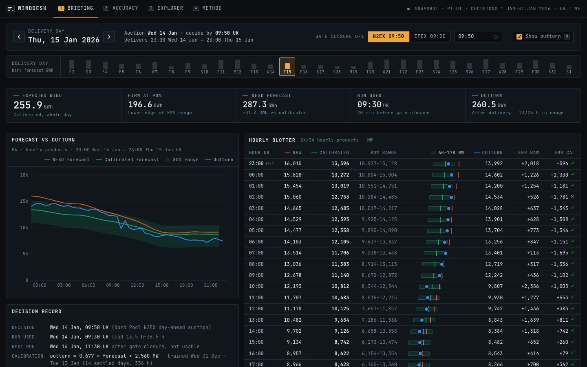
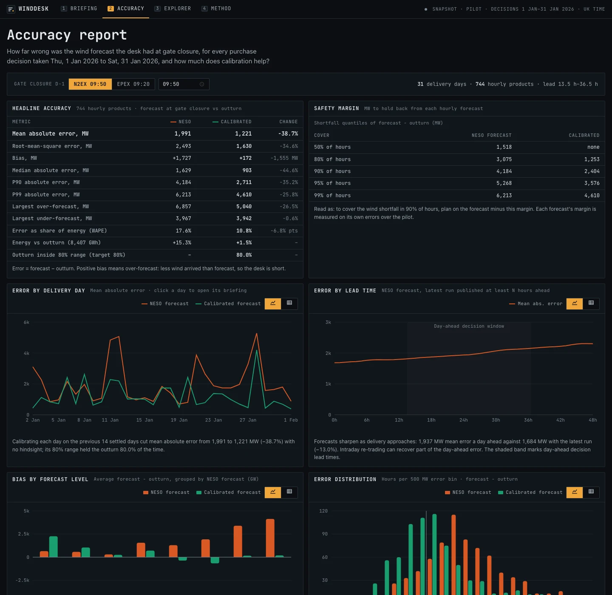

# WindDesk: day-ahead wind forecast monitoring

WindDesk helps a UK utility's day-ahead trading desk answer two questions before every
GB day-ahead auction:

1. **What was the latest national wind forecast available when we had to decide?**
2. **How far can that forecast be trusted, in MW, so we can buy with the error in mind?**

It rebuilds, for every purchase decision taken in January 2026, exactly the forecast
that was public at gate closure on the day before delivery. It then measures how wrong
that forecast turned out to be, and adds a hindsight-free **calibrated forecast with an
80% range** that cut the day-ahead error by 39% over the pilot.

| | |
|---|---|
| **Live app** | **https://YOUR-PROJECT.vercel.app** *(replace with the Vercel URL after deployment)* |
| **API docs** | `/api/docs` on the same host (interactive OpenAPI) |
| **Data** | Elexon Insights (BMRS) `WINDFOR` forecasts and `FUELHH` wind outturn, national level |
| **Stack** | React 19 + TypeScript (Vite) · Python 3.12 + FastAPI · Docker · Vercel |



---

## Contents

- [Pilot results](#pilot-results)
- [What the app does](#what-the-app-does)
- [Quick start](#quick-start)
- [Repository layout](#repository-layout)
- [Architecture](#architecture)
- [Methodology](#methodology)
- [API](#api)
- [Quality and engineering practices](#quality-and-engineering-practices)
- [Deployment](#deployment)
- [Refreshing the data](#refreshing-the-data)
- [Limitations and next steps](#limitations-and-next-steps)
- [Use of AI tools](#use-of-ai-tools)

---

## Pilot results

These are the purchase decisions taken 1 to 31 January 2026: 31 delivery days and
744 hourly products, with Nord Pool N2EX gate closure at 09:50 UK on D-1. Every number
comes from the API and is pinned by a regression test
(`backend/tests/test_snapshot_regression.py`).

| Metric (forecast − outturn) | NESO forecast at gate closure | Calibrated forecast | Change |
|---|---:|---:|---:|
| Mean absolute error | 1,991 MW | **1,221 MW** | **−38.7%** |
| Root-mean-square error | 2,493 MW | 1,630 MW | −34.6% |
| Bias (positive = over-forecast) | +1,727 MW | +172 MW | −1,555 MW |
| P90 absolute error | 4,184 MW | 2,711 MW | −35.2% |
| Error as share of energy (WAPE) | 17.6% | 10.8% | −6.8 pts |
| Energy vs outturn (8,407 GWh) | +15.3% | +1.5% | |
| Outturn inside the 80% range | | **80.0%** (595 of 744 h) | target 80% |

What the desk should take away:

- **The raw forecast systematically over-forecasts metered wind.** The average gap is
  1.7 GW, or 15% more energy than arrived. Taken at face value, it leaves the desk short.
- **The gap grows with the wind.** When 18 to 21 GW was forecast, outturn came in
  3.4 GW lower on average, against 0.6 GW when 3 to 6 GW was forecast. This pattern is
  consistent with high-wind curtailment, and it is why the calibration scales the
  forecast rather than shifting it.
- **A transparent two-parameter calibration fixes most of it.** It is refitted every day
  on the 14 most recent settled days, with no hindsight. It cut mean absolute error by 39%,
  and its 80% range held the outturn 80.0% of the time, so the range is well calibrated.
- **Safety margin:** to cover the wind shortfall in 90% of hours, hold back 4.2 GW from
  the raw forecast but only 2.4 GW from the calibrated one.
- **Lead time matters.** Mean error is 1,937 MW a day ahead and 1,684 MW with the latest
  run (−13%), which is the value of re-trading intraday. The 09:50 N2EX gate closure, which
  uses the 09:30 run, is slightly more accurate than EPEX's 09:20, which has to use the
  07:30 run (MAE 1,991 vs 2,019 MW).

---

## What the app does

| View | Purpose |
|---|---|
| **Briefing** (`/briefing/:date`) | The desk's morning screen for one delivery day. It has these parts: <ul><li>a quote line: expected wind, energy firm at 90%, NESO forecast, the run used, outturn</li><li>the forecast against outturn, with the calibrated 80% range</li><li>a 24-row **hourly blotter** linked to the chart</li><li>how the forecast evolved run by run; runs published after gate closure are drawn dashed</li><li>a decision record showing the cutoff, the run used and the calibration</li></ul> `←`/`→` step through days and `O` toggles the outturn. |
| **Accuracy** (`/accuracy`) | The pilot evaluation: <ul><li>a headline NESO-vs-calibrated table and safety margins</li><li>error by delivery day, lead time, forecast level and hour of day</li><li>the error distribution, forecast vs outturn, and the largest misses (each linked to its briefing)</li></ul> |
| **Explorer** (`/explorer`) | Any range of delivery days, in one of two modes:<ul><li>**at gate closure**: what the desk actually saw</li><li>**fixed lead time**: the latest run at least N hours ahead, 0–48 h</li></ul>It has a zoomable chart and a table view. |
| **Methodology** (`/methodology`) | Every definition, assumption and limitation, written for the client. |

The decision time can be switched on any view between the Nord Pool N2EX (09:50) and
EPEX SPOT GB (09:20) gate closures, or set to a custom time. It is kept in the URL
(`?gc=09:20`), so every view is shareable. Every chart has a table view, and the whole
UI is keyboard-operable (`1`–`4` switch sections).



---

## Quick start

### Option A: Docker (one command, production-like)

```bash
docker compose up --build
# open http://localhost:8000
```

A single image serves the API and the built React app. It runs as a non-root user, has a
health check, and honours `PORT` so it also runs on Heroku or any container host.

### Option B: local development (hot reload)

You need Python 3.11 or later (3.12 recommended) and Node 22 or later.

```bash
# Backend: http://localhost:8000 (API docs at /api/docs)
cd backend
python3.12 -m venv .venv && source .venv/bin/activate   # any Python 3.11+
pip install -r requirements-dev.txt
uvicorn app.main:app --reload

# Frontend: http://localhost:5173 (proxies /api to :8000)
cd frontend
npm ci
npm run dev
```

### Running the checks

```bash
# Backend: format, lint, strict typing, 95 tests (99% coverage)
cd backend
ruff format --check app tests ../api && ruff check app tests ../api && mypy && pytest --cov

# Frontend: format, lint, typing, 36 tests, production build
cd frontend
npm run format:check && npm run lint && npm run typecheck && npm test && npm run build
```

The same checks, plus a Docker build and smoke test, run in GitHub Actions
(`.github/workflows/ci.yml`).

---

## Repository layout

```text
.
├── api/
│   └── index.py              Vercel serverless entry point (wraps the FastAPI app)
├── backend/
│   ├── app/
│   │   ├── main.py           FastAPI app factory: routes, error handling, caching, SPA serving
│   │   ├── config.py         Settings (pilot window, gate closure, calibration), env-overridable
│   │   ├── schemas.py        Pydantic response models (camelCase JSON contract)
│   │   ├── ingest.py         CLI: fetch from Elexon, validate, write the data snapshot
│   │   ├── api/              HTTP layer: routes.py (5 GET endpoints), dependencies.py
│   │   ├── services/
│   │   │   └── analytics.py  Decision forecasts, calibration, briefing, explorer and accuracy views
│   │   ├── domain/           Pure logic, no I/O:
│   │   │   ├── market.py         GB day-ahead conventions (delivery day, gate closure, DST)
│   │   │   ├── forecast_book.py  "Latest forecast as of time t" index, outturn series
│   │   │   ├── metrics.py        MAE, RMSE, bias, percentiles, WAPE, correlation
│   │   │   ├── calibration.py    Walk-forward linear calibration and empirical range
│   │   │   └── models.py         Forecast and outturn records
│   │   └── data/
│   │       ├── elexon_client.py  BMRS stream client: chunking, retries, schema validation
│   │       ├── repository.py     Snapshot read/write with SHA-256 checks, live loading
│   │       ├── quality.py        Completeness checks (missing periods, gaps)
│   │       └── snapshot/         Versioned January 2026 data (gzip JSON + manifest)
│   ├── tests/                95 pytest tests (unit, API, client, leakage, regression)
│   ├── pyproject.toml        Ruff, mypy (strict) and pytest configuration
│   └── requirements-dev.txt  Test and lint tooling (includes ../requirements.txt)
├── frontend/
│   ├── src/
│   │   ├── main.tsx, App.tsx Providers, routing, lazy-loaded pages
│   │   ├── api/              Typed API client, contracts, React Query hooks
│   │   ├── pages/            Briefing, Accuracy, Explorer, Methodology
│   │   ├── components/       Shell, Blotter, DayRail, GateClosureControl, Panel, Quotes, DataTable…
│   │   │   └── charts/       Forecast, evolution and accuracy charts (Recharts)
│   │   ├── lib/              UK-time formatting, dates, chart scales, series colours, URL state
│   │   ├── styles/global.css Design tokens and component styles (terminal theme)
│   │   └── test/             Test setup and fixtures
│   ├── index.html            App shell (includes the design contract)
│   └── package.json          Scripts and pinned dependencies
├── docs/
│   ├── architecture.md       Design decisions and trade-offs for the technical reviewer
│   ├── video-script.md       Talk track for the two-part demo video
│   └── images/               Screenshots used in this README
├── .github/workflows/ci.yml  CI: backend, frontend, Docker build and smoke test
├── Dockerfile                Multi-stage build: React build → slim Python runtime
├── docker-compose.yml        Local production-like run
├── vercel.json               Vercel build, Python function, rewrites and headers
├── requirements.txt          Pinned Python runtime dependencies (Docker, Vercel, local)
├── .python-version           Python version for Vercel (3.12)
├── PRODUCT.md                Product brief: users, purpose, principles
└── DESIGN.md                 Visual design system as built
```

---

## Architecture

```text
            ┌──────────────── build time ─────────────────┐
 Elexon     │  python -m app.ingest                       │
 BMRS API ──┼─▶ ElexonClient (chunked, retried, validated) │
 WINDFOR    │  ─▶ quality checks ─▶ snapshot/*.json.gz     │
 FUELHH     │     + manifest.json (counts, SHA-256)        │
            └──────────────────────────────────────────────┘
                                   │ (committed, versioned)
                                   ▼
 ┌────────────────────────── FastAPI (Python 3.12) ──────────────────────────┐
 │ repository.load_snapshot ─▶ ForecastBook / ActualSeries  (indexed, O(log n))│
 │                ─▶ ForecastAnalytics  (decision forecasts, walk-forward      │
 │                    calibration, metrics; memoised per gate closure)         │
 │ /api/meta  /api/briefing  /api/timeseries  /api/accuracy  /api/health       │
 └───────────────────────────────────────────────────────────────────────────┘
                                   ▲ JSON (camelCase, UTC)
 ┌──────────────── React 19 + TypeScript (Vite) ─────────────────┐
 │ React Query (cache, keep-previous-data) · React Router (URL   │
 │ state) · Recharts · UK-time formatting · terminal design system│
 └────────────────────────────────────────────────────────────────┘

 Docker: one image serves /api and the built SPA.   Vercel: SPA on the CDN, /api → Python function.
```

Key decisions (more detail in [`docs/architecture.md`](docs/architecture.md)):

- **The decision time drives everything.** The core is one query: "the latest forecast
  for hour *t* published at or before *x*". `ForecastBook` keeps each target hour's runs
  sorted, so that query is a binary search.
- **Pure domain layer.** Market rules, selection, metrics and calibration do no I/O. That
  makes them fast and directly unit-testable, including clock-change days.
- **Versioned data snapshot instead of live calls per request.** The pilot window is
  historical, so the API serves a checksummed snapshot built by the ingestion CLI. Results
  are reproducible, cold starts are fast, and the API keeps working when Elexon is slow.
  `WINDDESK_DATA_SOURCE=live` fetches the same window at start-up instead.
- **No hindsight.** Calibration trains only on delivery days fully settled before gate
  closure. A test alters every value published after the cutoff and asserts the decision
  view is unchanged.
- **Lightweight runtime.** There is no pandas or NumPy: the statistics are small and use
  the standard library, so the serverless bundle stays tiny and cold starts are quick.

---

## Methodology

The full version is on the app's Methodology page. In short:

- **Delivery day D** runs from 23:00 UK on D-1 to 23:00 UK on D (Nord Pool GB Day-ahead
  Market Regulations, s.2.2.6). **Gate closure** on D-1 is 09:50 UK (N2EX) or 09:20 UK
  (EPEX SPOT GB). All UK-time handling uses `Europe/London`, so GMT/BST and 23- or
  25-hour days are correct.
- **Decision forecast:** for each hourly target in D, the latest WINDFOR value with
  `publishTime ≤ gate closure`. With the 09:50 gate closure that is the 09:30 run, at
  lead times of 13.5 to 36.5 h.
- **Matching:** each hourly forecast is compared with the FUELHH settlement period
  starting at the same `startTime`. Hourly-mean and centred alignments changed MAE by
  less than 1.5%.
- **Error = forecast − outturn.** A positive error is an over-forecast: the desk is short.
- **Calibration:** `outturn ≈ a + b × forecast`, fitted by ordinary least squares on the
  14 most recent delivery days settled before gate closure (D-15 to D-2). The 80% range
  is the fitted value plus the 10th and 90th percentiles of the training residuals. The
  first January decisions therefore train on December 2025 data that was public at the time.
- **Scope:** decisions taken 1 to 31 January 2026, i.e. delivery 2 January to 1 February
  2026. That is 31 days and 744 hourly products, with every settlement period present.

---

## API

All endpoints are read-only `GET` requests returning camelCase JSON. Instants are UTC and
power is in MW. The interactive docs are at `/api/docs`.

| Endpoint | Description |
|---|---|
| `/api/health` | Liveness and data source |
| `/api/meta` | Pilot window, gate-closure presets, calibration settings, data lineage |
| `/api/briefing?deliveryDate=2026-01-15&gateClosure=09:50` | One delivery day: decision forecast, calibration and range, outturn, forecast runs, metrics |
| `/api/timeseries?from=2026-01-10&to=2026-01-16&mode=decision\|lead&leadHours=24` | Forecast vs outturn over a range of days |
| `/api/accuracy?gateClosure=09:50` | Full pilot evaluation (metrics, by day, lead, hour, level, histogram, margins, scatter) |

Invalid input returns `422` with a readable `detail`. If the data source is unavailable
the API returns `503`, without leaking internals.

---

## Quality and engineering practices

- **Tests:**
  - **Backend: 95 pytest tests, 99% coverage.** They cover:
    - market rules, including both clock-change days
    - forecast selection at its boundaries
    - metric values against hand-computed results
    - calibration recovering a known distortion
    - the no-look-ahead property
    - the Elexon client against a mock transport (chunking, retries, back-off, malformed payloads)
    - snapshot integrity (checksums, round-trips)
    - every API endpoint and error path
    - SPA serving and path traversal
    - the Vercel adapter
    - regression of the headline numbers on the real data
  - **Frontend: 36 Vitest + Testing Library tests.** They cover formatters and UK-time
    edge cases, the API client error handling, the blotter, controls, keyboard navigation,
    and page-level integration with a mocked API.
- **Static analysis:**
  - Backend: Ruff (lint and format) and mypy in strict mode, on both app and tests.
  - Frontend: TypeScript `strict` with `noUncheckedIndexedAccess`, oxlint (including
    a11y rules) with zero warnings, and Prettier.
- **Reproducibility:** pinned dependencies (`requirements.txt`, `package-lock.json`), and a
  deterministic data snapshot (gzip with fixed mtime) whose manifest records record counts
  and SHA-256 checksums. Loading fails loudly on tampering.
- **Resilience:** the Elexon client retries throttling, server errors and network faults
  with exponential back-off. The API maps data outages to `503`, and the UI shows retry
  states, keeps the previous view at reduced opacity while refetching, and handles empty
  states.
- **Performance:** the full accuracy report computes in about 0.1 s and is memoised; responses
  are gzip-compressed and CDN-cacheable; and secondary pages and chart libraries are
  code-split.
- **Accessibility:** WCAG-minded throughout:
  - keyboard operation and visible focus
  - text contrast of at least 4.5:1 (WCAG AA)
  - chart colours validated for colour-vision deficiency
  - colour never the only signal
  - a table view for every chart
  - `prefers-reduced-motion` respected
- **Security:** no secrets are needed. The container runs as non-root, the frontend
  serving is protected against path traversal, and security headers are set on Vercel.

---

## Deployment

### Vercel (live app)

`vercel.json` builds the React app (served from the CDN) and deploys `api/index.py` as a
Python function. `/api/*` is rewritten to the function and every other path to the
single-page app.

```bash
npm i -g vercel          # or use npx vercel
vercel login
vercel deploy --prod     # from the repository root
```

You can also import the GitHub repository in the Vercel dashboard; the settings are read
from `vercel.json`, so no further configuration is needed.

### Any container host (e.g. Heroku)

```bash
docker build -t winddesk .
docker run -p 8000:8000 winddesk                  # local
heroku container:push web && heroku container:release web   # Heroku
```

---

## Refreshing the data

```bash
cd backend && source .venv/bin/activate
python -m app.ingest            # rewrites app/data/snapshot/ and its manifest
pytest                          # the regression test flags any change in headline numbers
```

The pilot window and model settings are configuration and can be overridden with
environment variables:

- `WINDDESK_FIRST_DECISION_DATE` and `WINDDESK_LAST_DECISION_DATE` set the window.
- `WINDDESK_CALIBRATION_WINDOW_DAYS` sets the calibration look-back.
- `WINDDESK_DATA_SOURCE=snapshot|live` chooses the data source.

---

## Limitations and next steps

- **Wind only.** Without the desk's demand forecast, WindDesk cannot turn the range into
  a purchase volume. Adding demand data would turn it into a direct "buy between X and Y
  MWh" recommendation.
- **Cause of the bias not confirmed.** It is unconfirmed from these two datasets. The
  dependence on forecast level is consistent with curtailment and metering scope, and
  should be confirmed with NESO.
- **Short sample.** A month is short, and few hours had very low forecasts, where the
  linear calibration is least certain. The evaluation should run continuously, and the
  range should be checked against a full season.
- **Production path.**
  - an hourly scheduled ingestion into a time-series database, with alerts when the
    calibrated range widens sharply
  - solar (also in BMRS) using the same pipeline
  - authentication for the client's users

---

## Use of AI tools

This project was built with the help of an AI coding assistant, **Claude Code
(Anthropic)**. It was used for:

- researching the GB day-ahead market rules and the BMRS datasets
- exploratory analysis and back-testing of the calibration
- writing and refactoring code and tests
- design review of the UI
- drafting the documentation

All analysis results were verified against the live Elexon data. The code is covered by
the automated checks described above.
